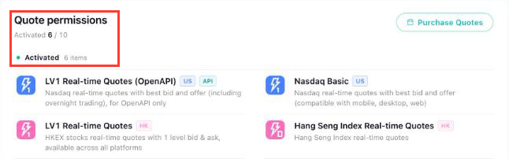

# Longbridge Remotion Charts

Turn your **Hong Kong and US stock** holdings into animated chart videos (MP4, 1920×1080, 60fps). No coding needed.


<sub>Sped up 2.5× for the README; the rendered video plays at normal speed, 60fps.</sub>

| Portfolio | Compare |
|---|---|
|  |  |

- **Portfolio** chart: your shares (for example 100 Tencent + 50 Nvidia) added up into one portfolio value, animated over time.
- **Compare** chart: put the same amount (for example $1,000) into 2 to 4 stocks on the same day and watch which one wins.

Mix HK and US stocks freely; everything is shown in one currency (USD or HKD). Prices come from your own [Longbridge](https://open.longbridge.com/skill?invite-code=FLJS39) account. **No API key needed.** Built with [Remotion](https://www.remotion.dev).

> **Prefer to let an AI do the setup?** If you use Claude Code, Codex, Cursor or another AI coding assistant, ask it: *"Clone https://github.com/ke11/longbridge-remotion-charts, follow its AGENTS.md to set it up, and make me a video."* It does the setup and walks you through the few steps only you can do.

---

## Before you start: the terminal

A few steps below ask you to type commands into a **terminal**. It's a text window where you type a command and press **Enter**.

- **macOS:** press ⌘ + Space, type **Terminal**, press Enter.
- **Windows:** open the Start menu, type **PowerShell**, press Enter.

Copy each command from this page, paste it into the terminal, and press Enter. Setup takes about 15 minutes the first time.

## What you need

1. [Node.js 18 or newer](#1-nodejs-18-or-newer)
2. [A Longbridge account with quote permissions](#2-a-longbridge-account-with-quote-permissions)
3. [The Longbridge command-line tool (CLI)](#3-the-longbridge-command-line-tool-cli)

### 1. Node.js 18 or newer

Node.js is what runs this project. Download the **LTS** version from <https://nodejs.org> and install it like any other app. The installer asks for your computer's password.

### 2. A Longbridge account with quote permissions

Quote permissions are what let your account fetch stock prices.

1. Sign up for [Longbridge](https://open.longbridge.com/skill?invite-code=FLJS39).
2. Open the [Longbridge Developer Center](https://open.longbridge.com/dashboard) and sign in with the same account.
3. Look at **Quote permissions**. It should say **Activated**, with a number (a new account shows **6**):

   

   If it shows none, follow the Developer Center's prompts to activate OpenAPI access first.

> **Important:** do this check **before** step 3 of the [Quick start](#quick-start), where you log in from the terminal. A terminal login made while the account has no quote permissions stays without them, and every price request fails. Signing in to the Developer Center website is fine.

Basic quotes for HK and US stocks are free, with a monthly limit on how many different stocks you can look up.

### 3. The Longbridge command-line tool (CLI)

This small tool is how the project fetches prices with your account. Paste **one** of these into a terminal:

| Your computer | Command |
|---|---|
| macOS with [Homebrew](https://brew.sh) | `brew install --cask longbridge/tap/longbridge-terminal` |
| macOS or Linux, no Homebrew | `curl -sSL https://open.longbridge.com/longbridge/longbridge-terminal/install \| sh` |
| Windows | `iwr -useb https://open.longbridge.com/longbridge/longbridge-terminal/install.ps1 \| iex` |

- The macOS/Linux command may ask for your computer's **login password**. Nothing appears while you type it; that's normal. Press Enter when done. (Your user must be an administrator.)
- When it finishes, **close the terminal and open a new one**, so it can find the new `longbridge` command.

## Quick start

Run these one at a time, in a terminal.

**1. Download this project** and go into its folder:

```bash
git clone https://github.com/ke11/longbridge-remotion-charts.git
cd longbridge-remotion-charts
```

<details>
<summary>No <code>git</code>? Download the ZIP instead</summary>

On the GitHub page, click **Code → Download ZIP** and unzip it. Then open a terminal in that folder:

- **Windows:** open the folder in File Explorer, click the address bar, type `powershell` and press Enter.
- **macOS:** in Terminal, type `cd ` (with a space), drag the unzipped folder onto the Terminal window, and press Enter.

On a new Mac, typing `git` may offer to install "command line developer tools". Click **Install** and wait, or use the ZIP.

</details>

**2. Install the project** (takes a minute or two):

```bash
npm install
```

You'll see warnings and maybe a "vulnerabilities" message. That's normal. **Don't** run `npm audit fix --force`.

> **Windows: "running scripts is disabled on this system"?** Run this once, then try again: `Set-ExecutionPolicy -Scope CurrentUser RemoteSigned` (answer **Y**; no admin needed). Or type `npm.cmd` instead of `npm` in every command.

**3. Check everything and log in to Longbridge:**

```bash
npm run setup
```

It checks each requirement and tells you exactly what's missing. If you're not logged in yet, it reminds you to check your quote permissions, waits for you to press Enter, then starts the Longbridge login: open the link it prints, sign in, and type in the code. You only do this once per computer.

You're ready when it ends with:

```text
✓ Logged in to Longbridge
✓ Quote permissions: 6 activated

All set! Start the editor with npm run dev
```

**4. Open the editor:**

```bash
npm run dev
```

**Remotion Studio** opens in your browser (usually <http://localhost:3000>). Keep the terminal open while you use it; press Ctrl + C in the terminal to stop.

## Make your video

1. In Studio's left sidebar, click **PortfolioLineChart** or **CompareLineChart**.
2. In the **Props** panel on the right, change the settings, such as your stocks, start date and currency (see [Settings](#settings)). The preview reloads with real prices.
3. Press **Space** to play it.
4. Click **Render** (top right), then **Render video**. Your MP4 is saved in the project's `out/` folder.

### Settings

The Props panel has three groups.

**`config`**: what to fetch and how long the video runs.

| Setting | What it does |
|---|---|
| `startDate` | First day of the chart, as `YYYY-MM-DD` (for example `2024-01-02`). The chart runs from here to today. |
| `interval` | `day` for one point per trading day, or `month` for one per month (better for several years). |
| `displayCurrency` | `USD` or `HKD`. Every amount on screen uses this currency. |
| `usdHkd` | The USD→HKD exchange rate used when you mix markets. `7.8` is fine. |
| `durationSeconds` | Video length in seconds (up to 180). `0` picks a length for you. |
| `amount` | *Compare only.* How much goes into each stock on the start date. |

**`holdings`** (Portfolio) or **`tickers`** (Compare): your stocks.

| Setting | What it does |
|---|---|
| `symbol` | The stock, like `NVDA.US` or `0700.HK`. A plain `NVDA` means US and a plain `700` means HK. |
| `quantity` | *Portfolio only.* How many shares you hold. |
| `label` | Name to show, like `Tencent`. Leave blank to show the symbol. |
| `color` | Line colour, like `#76b900` or `teal`. Leave blank for an automatic colour. |

In Compare, the **first** stock is your pick, and the others (up to 3 more) are what it's compared with.

**`style`**: the look.

| Setting | What it does |
|---|---|
| `theme` | `dark` or `light`. |
| `gainColor` | `green` (default): gains green, losses red. `red`: gains red, losses green, as in Hong Kong and mainland China. |
| `title` | Small heading at the top left. Default: `WhaleAgent`. |
| `logoUrl` | Image next to the title: an image URL, or the name of a file you put in the `public/` folder. Default: the WhaleAgent logo. Leave blank for none. |
| `showAttribution` | Shows "Market data provided by Longbridge AI" at the bottom right. |

### Good to know

- Only **Hong Kong (`.HK`)** and **US (`.US`)** stocks work.
- Enter a stock the same way each time: `700` and `0700.HK` count as two different stocks.
- If your start date is before a stock was listed, the chart simply starts on the first day every stock has a price.
- Prices are adjusted for stock splits, so splits don't show up as fake crashes.

<details>
<summary><b>Render from the terminal instead of Studio</b></summary>

```bash
npm run render                          # both charts, with the default settings
npm run render -- PortfolioLineChart    # just one chart
```

Videos are saved in `out/`, named after the chart and its dates, for example `out/portfolio-month-2021-01-to-2026-10.mp4`.

To use your own settings, save them in a file in the project folder (next to `package.json`), for example `my-portfolio.json`. On Windows, in Notepad choose **Save as type: All files**, so it isn't saved as `my-portfolio.json.txt`.

```json
{
  "config": { "startDate": "2024-01-02", "interval": "day", "displayCurrency": "HKD", "usdHkd": 7.8, "durationSeconds": 0 },
  "holdings": [
    { "symbol": "0700.HK", "quantity": 200, "label": "Tencent", "color": "" },
    { "symbol": "TSLA.US", "quantity": 10, "label": "", "color": "" }
  ],
  "style": { "theme": "light", "gainColor": "green", "title": "WhaleAgent", "logoUrl": "https://whaleagent.io/_emdash/api/media/file/01M1M2A4WW7NQN75CEQS3D96QT.png", "showAttribution": true }
}
```

Then run:

```bash
npm run render -- PortfolioLineChart out/my-portfolio.mp4 --props=my-portfolio.json
```

Copy the whole example and change the values; keep all three groups (`config`, `holdings` or `tickers`, `style`), or the missing ones fall back to built-in defaults. For Compare, use `tickers` (without `quantity`) and add `"amount": 1000` to `config`.

To change the starting values Studio shows, edit `src/Root.tsx`.

</details>

## Troubleshooting

First, run `npm run setup`. It checks everything and tells you what to fix (every line marked ✗).

| You see | Fix |
|---|---|
| `longbridge: command not found` / `not recognized` | Install the [Longbridge CLI](#3-the-longbridge-command-line-tool-cli), then open a **new** terminal. |
| `running scripts is disabled on this system` (Windows) | Run `Set-ExecutionPolicy -Scope CurrentUser RemoteSigned` once (answer **Y**), or type `npm.cmd` instead of `npm`. |
| ✗ No quote permissions, "permission denied", quota or "out of limit" errors | You logged in while the account had no quote permissions. Check the [Developer Center](https://open.longbridge.com/dashboard) shows **Quote permissions** activated, then run `longbridge auth login` again. Still failing? Run `longbridge auth logout`, then `longbridge auth login`. If setup shows ✓ Quote permissions, you've probably used up this month's stock limit; check <https://open.longbridge.com>. |
| `not authenticated`, `token` or `login` errors | Run `longbridge auth login` again. Logins expire if unused for a while. |
| `invalid symbol` | That stock doesn't exist on Longbridge. Use the `NVDA.US` / `0700.HK` style and check the spelling. |
| `no daily bars since …` / `no monthly bars since …` | No prices after your start date: the symbol is wrong or the stock was delisted. |
| `only .US and .HK listings are supported` | Remove that stock; other markets aren't supported. |
| `Add at least two different tickers to compare.` | Compare needs 2 to 4 different stocks. |
| `Add at least one holding with a symbol and a quantity.` | Give at least one stock a symbol and a quantity above 0. |
| `startDate … is not in the past.` | Pick an earlier start date. |
| `Request rate limit` | Too many requests at once. Wait a minute and try again. |
| `cannot reach the local proxy` | Start with `npm run dev` or `npm run render` (not `npx remotion …`). |
| `Port 3011 is used by another program` | Close the other program, or run `LONGBRIDGE_PROXY_PORT=3012 npm run dev` (Windows: `$env:LONGBRIDGE_PROXY_PORT=3012; npm run dev`). |
| Can't log in to a US account from mainland China | Run `LONGBRIDGE_REGION=global longbridge auth login`. |

A failed render can print a long `ProtocolError` message first. The real error is near the end, after `An error occurred:`.

## How it works

Remotion builds each video inside a browser page, and a browser page can't run the Longbridge CLI. So `npm run dev` and `npm run render` also start a tiny **local proxy** (`scripts/longbridge-proxy.mjs`) on `127.0.0.1:3011` (set `LONGBRIDGE_PROXY_PORT` to change it). Only pages on your own computer can use it. It runs `longbridge kline history …` for each stock and returns the prices.

Your Longbridge login stays in the CLI's own storage on your computer. This project never reads, stores or sends any key, secret or token.

```
scripts/
  setup.mjs              npm run setup: checks Node, dependencies, CLI, login and quote permissions
  dev.mjs                npm run dev: proxy + Remotion Studio
  render.mjs             npm run render: proxy + remotion render
  longbridge-proxy.mjs   local price proxy (wraps the Longbridge CLI)
src/
  Root.tsx               the two compositions and their starting settings
  data/longbridge.ts     fetches prices from the local proxy
  compositions/
    PortfolioLineChart/  portfolio chart (data, schema, theme, timeline, …)
    CompareLineChart/    comparison chart (reuses the portfolio chart's parts)
    shared/geometry.ts   chart maths shared by both
```

## For AI coding agents

[`AGENTS.md`](AGENTS.md) has step-by-step setup instructions written for AI agents.

## License

- This project's code: [MIT](LICENSE).
- **Remotion has its own license.** It's free for individuals and companies with up to 3 employees; larger companies need a [Remotion company license](https://www.remotion.dev/license).
- **Market data** is fetched with your own Longbridge account and is subject to [Longbridge's terms](https://longbridge.com). Check them before publishing videos commercially.
- Fonts: [Geist](https://vercel.com/font) (SIL Open Font License), loaded through `@remotion/google-fonts`.
