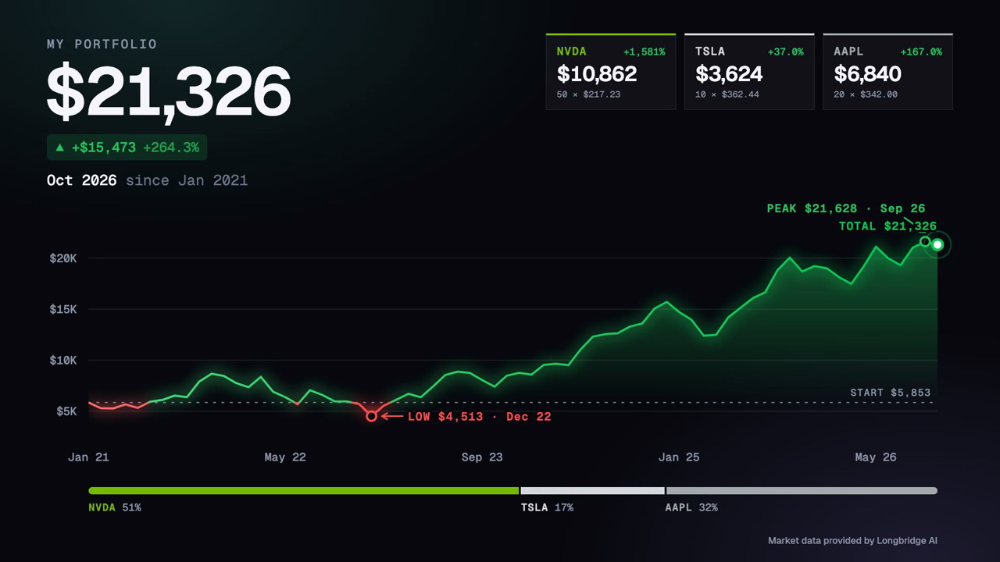
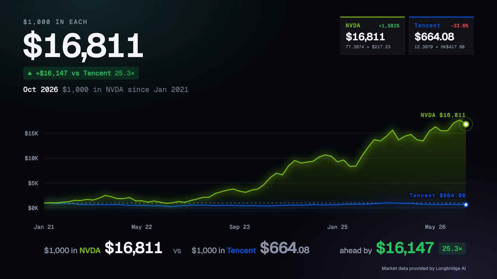

# Longbridge Remotion Charts

Turn your **Hong Kong and US stock** holdings into animated chart videos (MP4, 1920×1080, 60fps).

| Portfolio | Compare |
|---|---|
|  |  |

- **PortfolioLineChart**: your holdings (for example 100 × `0700.HK` + 50 × `NVDA.US`) added up into one portfolio value, animated over time.
- **CompareLineChart**: put the same amount (for example $1,000) into 2 to 4 stocks on the same day and watch which one wins.

HK and US stocks can be mixed freely. Prices are converted into one currency (USD or HKD) of your choice.

Built with [Remotion](https://www.remotion.dev). Market data from [Longbridge](https://longbridge.com) through your own Longbridge account. **No API key needed.**

> Not affiliated with or endorsed by Longbridge.

---

## What you need

1. **A computer** running macOS, Windows or Linux.
2. **Node.js 18 or newer.** Download the **LTS** version from <https://nodejs.org> and install it.
3. **A Longbridge account.** Sign up in the [Longbridge app](https://longbridge.com/download). Basic (LV1) quotes for HK and US stocks are free through the OpenAPI, with a monthly limit on how many different symbols you can look up.
4. **The Longbridge command-line tool (CLI).** Install it with **one** of these:

   | Your computer | Paste this into a terminal |
   |---|---|
   | macOS (with [Homebrew](https://brew.sh)) | `brew install --cask longbridge/tap/longbridge-terminal` |
   | macOS / Linux (without Homebrew) | `curl -sSL https://open.longbridge.com/longbridge/longbridge-terminal/install \| sh` |
   | Windows (PowerShell) | `iwr https://open.longbridge.com/longbridge/longbridge-terminal/install.ps1 \| iex` |

   After installing, **close the terminal and open a new one**, so it can find the `longbridge` command.

> **What is a terminal?** On macOS, open the **Terminal** app (search with ⌘ + Space). On Windows, open **PowerShell** from the Start menu. You type commands there and press Enter.

## Quick start

```bash
# 1. Download the project and go into its folder
git clone https://github.com/ke11/longbridge-remotion-charts.git
cd longbridge-remotion-charts

# 2. Install the project's dependencies (takes a minute; warnings are normal)
npm install

# 3. Check everything and log in to Longbridge
npm run setup

# 4. Open the editor in your browser
npm run dev
```

No `git`? On the GitHub page, click **Code → Download ZIP**, unzip it, and open a terminal in that folder instead of step 1. (Windows: open the folder in File Explorer, click the address bar, type `powershell` and press Enter.)

In step 3, `npm run setup` checks each requirement and tells you exactly what is missing. If you are not logged in, it starts `longbridge auth login` for you. Open the link it prints, sign in to Longbridge and type in the code. You only do this once per computer.

In step 4, **Remotion Studio** opens in your browser (usually <http://localhost:3000>).

## Make your video

1. In Studio's left sidebar, click **PortfolioLineChart** or **CompareLineChart**.
2. In the **Props** panel on the right, change the settings (see below). The preview reloads with real prices.
3. Press **Space** to play.
4. Click **Render** (top right), then **Render video**. The MP4 is saved in the `out/` folder.

Or render from the terminal without opening Studio:

```bash
npm run render                          # both charts, using the default settings
npm run render -- PortfolioLineChart    # just one chart
```

Videos are saved in `out/`, named after the chart and its dates, for example `out/portfolio-month-2021-01-to-2026-10.mp4`.

### Settings

**`config`** controls what is fetched and how long the video runs:

| Setting | What it does |
|---|---|
| `startDate` | First day of the chart, as `YYYY-MM-DD`. Must be in the past. The chart runs from here to today. |
| `interval` | `day` = one point per trading day. `month` = one point per month, good for long periods. |
| `displayCurrency` | `USD` or `HKD`. Every value on screen is shown in this currency. |
| `usdHkd` | The USD→HKD exchange rate used when you mix markets (7 to 8.5). The HKD is pegged at 7.75 to 7.85. |
| `durationSeconds` | Length of the video in seconds, up to 180. `0` picks a length automatically. |
| `amount` | *Compare only.* How much goes into each stock on the start date, in `displayCurrency`. Must be more than 0. |

**`holdings`** (Portfolio) and **`tickers`** (Compare) are your stocks:

| Setting | What it does |
|---|---|
| `symbol` | `NVDA.US`, `0700.HK`, … A bare `NVDA` is read as US and a bare `700` as HK. |
| `quantity` | *Portfolio only.* How many shares you hold. Rows with 0 are skipped. |
| `label` | Name shown on screen. Leave blank to use the symbol. |
| `color` | Line color, such as `#76b900` or `teal`. Leave blank for an automatic color. |

In Compare, the **first** stock is your pick and the others (up to 3) are what it is compared against. Any stocks after the fourth are ignored.

**`style`** only changes the look:

| Setting | What it does |
|---|---|
| `theme` | `dark` or `light`. |
| `colorConvention` | `us`: gains green, losses red (default). `hk`: gains red, losses green, the Hong Kong / mainland China convention. |
| `title` | Small heading at the top left. |
| `logo` | Image shown next to the title: a URL, or a file you put in the `public/` folder (type just its file name). Leave blank for none. |
| `showAttribution` | Shows "Market data provided by Longbridge AI" at the bottom right. |

### Render with your own settings from the terminal

Save your settings in a JSON file, for example `my-portfolio.json`:

```json
{
  "config": { "startDate": "2024-01-02", "interval": "day", "displayCurrency": "HKD", "usdHkd": 7.8, "durationSeconds": 0 },
  "holdings": [
    { "symbol": "0700.HK", "quantity": 200, "label": "Tencent", "color": "" },
    { "symbol": "TSLA.US", "quantity": 10, "label": "", "color": "" }
  ],
  "style": { "theme": "light", "colorConvention": "us", "title": "My Portfolio", "logo": "", "showAttribution": true }
}
```

Then run:

```bash
npm run render -- PortfolioLineChart out/my-portfolio.mp4 --props=my-portfolio.json
```

Give each group (`config`, `holdings`/`tickers`, `style`) in full. If you leave out a whole group, the starting values from `src/Root.tsx` are used. If you leave out one setting inside a group, the default from `src/compositions/*/schema.ts` is used instead. The two don't always match: for example, Compare's `amount` is 1000 in `Root.tsx` but 100 in `schema.ts`.

### Good to know

- Gains are **green** and losses **red** by default. For the Hong Kong / mainland China convention (gains red), set `style.colorConvention` to `hk`.
- Only **`.US`** and **`.HK`** stocks are supported.
- `700`, `0700` and `0700.HK` all work, but enter a stock the same way each time: a bare `700` becomes `700.HK`, which is counted separately from `0700.HK`.
- Prices are **forward-adjusted**, so stock splits don't show up as fake crashes.
- To change the starting values Studio shows, edit `src/Root.tsx`.

## Troubleshooting

| You see | Fix |
|---|---|
| `longbridge: command not found` / `not recognized` | Install the Longbridge CLI (see [What you need](#what-you-need)), then open a **new** terminal. |
| `not authenticated`, `token` or `login` errors | Run `longbridge auth login` again. Logins expire if they go unused for a while. |
| `cannot reach the local proxy` | Start the project with `npm run dev` or `npm run render`, not `npx remotion …` directly. Both start the price proxy for you. |
| `Port 3011 is used by another program` | Close the other program, or run `LONGBRIDGE_PROXY_PORT=3012 npm run dev` (Windows PowerShell: `$env:LONGBRIDGE_PROXY_PORT=3012; npm run dev`). |
| `invalid symbol` | The symbol doesn't exist on Longbridge. Use the `NVDA.US` / `0700.HK` style and check the spelling. This is not a login problem. |
| `no daily bars since …` / `Check the symbol` | Check the spelling, and that the stock was already listed on your start date. |
| `only .US and .HK listings are supported` | Remove that symbol; other markets aren't supported. |
| `Add at least two different tickers to compare.` | CompareLineChart needs 2 to 4 different symbols. |
| `Add at least one holding with a symbol and a quantity.` | Give at least one holding a symbol and a quantity above 0. |
| `startDate … is not in the past.` | Pick an earlier start date. |
| `permission` or `quote` errors from Longbridge | Check your OpenAPI quote access at <https://open.longbridge.com>. You may have used up this month's symbol limit. |
| Anything else | Run `npm run setup` and fix every line marked ✗. |

## How it works

Remotion loads chart data inside a browser page, and a browser page cannot run the Longbridge CLI. So `npm run dev` and `npm run render` also start a tiny **local proxy** (`scripts/longbridge-proxy.mjs`) on `127.0.0.1:3011` (set `LONGBRIDGE_PROXY_PORT` to use another port). Only pages on your own computer can use it. It runs `longbridge kline history …` for each stock and returns the prices as JSON.

Your Longbridge login stays in the CLI's own storage on your computer. This project never reads, stores or sends any key, secret or token.

```
scripts/
  setup.mjs              npm run setup: checks Node, dependencies, CLI and login
  dev.mjs                npm run dev: proxy + Remotion Studio
  render.mjs             npm run render: proxy + remotion render
  longbridge-proxy.mjs   local price proxy (wraps the Longbridge CLI)
src/
  Root.tsx               the two compositions and their starting settings
  data/longbridge.ts     fetches prices from the local proxy
  compositions/
    PortfolioLineChart/  portfolio chart (data, schema, theme, timeline, …)
    CompareLineChart/    comparison chart (reuses the portfolio chart's parts)
    shared/geometry.ts   chart maths shared by both
```

## For AI coding agents

Using Claude Code, Codex, Cursor or another AI agent? Point it at [`AGENTS.md`](AGENTS.md). It has step-by-step install instructions written for agents.

## License

- This project's code: [MIT](LICENSE).
- **Remotion has its own license.** It is free for individuals and companies with up to 3 employees; larger companies need a [Remotion company license](https://www.remotion.dev/license).
- **Market data** is fetched with your own Longbridge account and is subject to [Longbridge's terms](https://longbridge.com). Check them before publishing videos commercially.
- Fonts: [Geist](https://vercel.com/font) (SIL Open Font License), loaded through `@remotion/google-fonts`.
